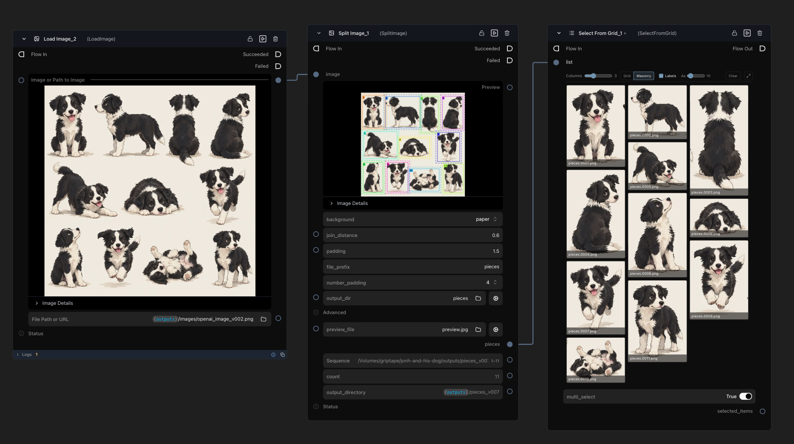

# Griptape Nodes scikit-image Library

Nodes for photos and scans of drawings, built on [scikit-image](https://scikit-image.org/). They split a character model sheet into one image per drawing, clean up and line up scans, trace marks into vectors, compare versions, and animate a still drawing with boiling lines. All of them are in the **Image** category.

| Node | What it does |
|---|---|
| [Split Image](#split-image) | Cut a model sheet into one image per drawing, with a live preview. |
| [Flatten Paper](#image-nodes) | Take shadows and gradients out of a photo or scan so the paper is white. |
| [Lines to Alpha](#image-nodes) | The marks on the paper as an alpha channel: white on a mark, black on paper. |
| [Trim to Content](#image-nodes) | Crop to the box that holds the marks. |
| [Equalize Contrast](#image-nodes) | Bring out detail with adaptive histogram equalization, on lightness only. |
| [Align Images](#image-nodes) | Shift, and if needed turn and scale, an image to line up with a reference. |
| [Compare Images](#image-nodes) | Score how alike two images are (SSIM) and show where they differ. |
| [Lines to SVG](#image-nodes) | Trace the marks into an SVG. |
| [Boiling Lines](#frame-nodes) | Frames of one drawing, each wobbled differently, with a live preview widget. |
| [Make In-Betweens](#frame-nodes) | Frames that move from one drawing to the next, by optical flow. |



Split Image on a sheet of eleven dog poses. The preview outlines and numbers each piece, with a dashed box for the padding. It found all eleven, and the saved pieces went into Select From Grid.

## Quick start

**Split a model sheet into poses.** Connect the photo to **Split Image**. The preview appears on the node, with each piece outlined, numbered and in its own colour, and dropped pieces hatched in red. Drag **Join distance** until each pose is one piece. Run the node to save the pieces in a folder such as `pieces_v001`.

**Make a boiling-line animation.** Connect a drawing to **Boiling Lines**, and play the preview in the widget to tune the wobble. Run the node, then wire its `frames` into Create Video from Frames and play it at 6 to 12 frames per second.

**Get the line art on its own.** Connect a scan to **Flatten Paper** to even out the light, then to **Lines to Alpha** to get the marks as a matte. Use the matte as a mask or an alpha on the drawing.

## Split Image

Finds the marks on the paper, joins the marks that sit close together into one piece, and crops each piece out. The pieces come back in reading order, left to right and then top to bottom, and each is saved as a PNG.

| | |
|---|---|
| **Image** (in) | The image to split, such as a photo or scan of a model sheet. |
| **Background** | `paper` keeps the paper around each piece. `transparent` clears everything outside the piece's shape. |
| **Join distance** | Marks closer together than this, as a percentage of the image's longer side, count as one piece. Raise it if a pose comes apart, for example a tail or a hand drawn a little away from the body. Lower it if two poses merge. Default 0.6. |
| **Padding** | Space to keep around each piece, as a percentage of the image's longer side. Default 1.5. |
| **File prefix** | The start of each file name, as in Extract Frames: `pieces.0001.png`, `pieces.0002.png` and so on. Default `pieces`. |
| **Number padding** | How many digits the piece number is zero-padded to. Default 4. |
| **Output dir** | A versioned folder in the project's outputs, `pieces_v001`, `pieces_v002` and so on, with the pieces inside it. The gear button creates and connects a Directory Output Settings node to choose another place. |
| **Advanced** | `sensitivity` is how different from the paper a mark must be to count, darker or lighter. Lower picks up fainter marks, such as light crayon, and also paper texture and shadows. Default 0.12. `min_size` drops pieces whose longest side is shorter than this, as a percentage of the image's longer side, which removes specks. Default 3. `ignore_corner_pieces` drops pieces that touch two edges of the image, such as a thumb holding the paper. A piece that touches only one edge is kept. |
| **Preview** (out) | The image with each piece outlined in its own colour and numbered in reading order. With padding, a dashed box in the same colour shows the crop that is saved. Dropped pieces are outlined in red and cross-hatched. It updates when you change the image or a setting, without running the node. |
| **Pieces** (out) | The pieces as images, in reading order. |
| **Sequence** (out) | The pieces as a sequence, to wire into Inspect Sequence or any other node that takes one. |
| **Count** (out) | How many pieces were found. |
| **Output directory** (out) | The folder the files were saved in. |

The paper or backdrop colour is estimated as a smooth surface across the whole image and compared against, so a phone photo with a shadow on one side works, and so do painted figures on a dark backdrop. The node stops with a message when it finds no pieces or more than 50. The message says which setting to change.

## Image nodes

Each takes an image, and a second one where noted, and saves a file in the project. The image inputs show only as connections.

| Node | Inputs and settings | Outputs |
|---|---|---|
| **Flatten Paper** | `strength`: 1 is fully flat. Default 1. | `output` |
| **Lines to Alpha** | `sensitivity` (default 0.12) is how different from the paper a mark must be to count. `softness` (default 0.15) is how gradually a mark fades in. Lower is crisper. | `alpha`, a greyscale image: white on a mark, black on paper. |
| **Trim to Content** | `sensitivity`, and `padding` as a percentage of the longer side. Default 1.5. | `output` |
| **Equalize Contrast** | `clip_limit` (default 0.02) and `strength` (default 1). It works on lightness only, so colours stay put. | `output` |
| **Align Images** | `reference`, and `mode`: shift only, shift and rotate, or shift, rotate and scale. It tries each and keeps what matches best, and returns the image unchanged if nothing helps. | `output`, `rotation` (degrees), `scale`, `shift_down`, `shift_right` |
| **Compare Images** | `other`, and `gain`, which brightens the differences. Default 3. | `similarity` (1 is the same), and `output` (white where they differ). |
| **Lines to SVG** | `sensitivity`, `simplify` (pixels), and `fill_colour`, chosen with a colour picker. Each stroke becomes a filled shape. | `preview`, the traced shapes as an image. `svg`, the location of the saved file and not the SVG text. `paths`, the number of shapes. |

## Frame nodes

These save a numbered sequence in a versioned folder, named like Extract Frames: `boil_v001/boil.0001.png`. They have `file_prefix`, `number_padding`, `even_size` and `output_dir` settings, and give back `frames`, `sequence`, `count` and `output_directory`. `even_size` is on by default. It crops a pixel off an odd width or height, because video encoders such as H.264 refuse odd sizes and Create Video from Frames would fail with an ffmpeg error.

| Node | Settings |
|---|---|
| **Boiling Lines** | `frame_count` (default 8, up to 96), `amplitude` shown as Amount (default 0.3), `wobble_size` (default 2) and `seed` (default 1). Amount and wobble size are percentages of the image's longer side. A transparent PNG keeps its transparency. |
| **Make In-Betweens** | `other` (the last drawing) and `in_between_count` (default 3). Works best on the same pose a little apart. |

### Boiling Lines preview


Boiling Lines in a workflow: a drawing goes in, the widget previews the wobble, and the 24 saved frames go into Create Video from Frames.

Boiling Lines has a widget that shows the wobble on your image before you run the node. Connect an image and it appears. The preview fills the widget and scales with the node, so make the node bigger to see more. The controls stay below it.

- **Playback:** a Play button, a scrubber for the frame, and the View buttons. **Result** is your image warped by the wobble. **Noise** draws the wobble itself, with the hue showing the direction each point is pushed, and the brightness and the arrows showing how far. **Original** is the image as it is, for comparing. **Frames** and **Preview speed** are here too. Preview speed is only for the widget and does not change the saved frames.
- **Wobble:** **Amount**, **Wobble size** and **Seed**, with a Random button for the seed.

Frames, Amount, Wobble size and Seed are also parameters of the node, in a "Boil settings" group. The widget and the parameters stay in step, so you can set them in either place or wire a value in.

The preview is drawn in the browser, so dragging a slider is instant. It uses the same noise as the node, a hash of the frame, position and seed with no random number generator, written in both Python (`noise.py`) and JavaScript (`widgets/BoilingLines/_noise.js`). The tests check that the two agree, and that the preview's pixels match the saved frames to within one colour level. Change one, and change the other. The preview is at most 720 pixels on its longer side, and the saved frames are at full size.

## Limits

- **Touching drawings merge.** Split Image joins marks that sit close together, so two poses that touch, or whose shadows touch, come out as one piece. Lowering **Join distance** can separate them, but can also split a single pose. No one value works for every sheet, which is why the preview is there.
- **Align Images** handles turns of any angle and scale changes up to about 10%. A big turn together with a big scale change can fail.
- **Make In-Betweens** follows motion, so it works when the two drawings are the same pose a little apart. A large change smears.
- **Lines to SVG** traces each stroke as a filled shape and not as a centre line, so it is not a vector stroke you can restyle.
- The nodes treat the paper or backdrop as the colour that covers most of the image. A drawing that fills the whole frame gives poor results.

## Troubleshooting

- **"No pieces were found"** or **"No marks were found".** Lower **Sensitivity**. For Split Image, also lower **Minimum size** or turn off **Ignore corner pieces** if a drawing sits in a corner.
- **A pose is cut in two, or two poses are in one piece.** Change **Join distance** and watch the preview.
- **Create Video from Frames fails with `width not divisible by 2`.** Leave **Even size** on, in Boiling Lines and Make In-Betweens.
- **An error like `takes 3 positional arguments but 4 were given` after an update.** The engine still holds an older copy of one of the library's modules. Restart the engine completely, not just the library.
- **The Boiling Lines preview says the browser would not let the widget read the image.** The widget reads the image's pixels in the browser, which needs the file server to allow it. The saved frames are not affected.

## Requirements

- Griptape Nodes 0.104.0 or newer.
- numpy, scipy, scikit-image and pillow. The engine installs them when it loads the library. The preview runs while you edit, so they are normal dependencies and not execution-only ones.

## Install

1. Run `gtn config show workspace_directory` to find your workspace directory.
2. Clone this repository into it.
3. In Griptape Nodes, open **Settings**, then **Libraries**, and add `griptape-nodes-library.json` from the clone.

## Development

```bash
make install/dev   # dev tools and the library's dependencies
make check         # format, lint, types, JSON, tests, changelog
```

The tests that check the Boiling Lines widget run its JavaScript, so they need [Node.js](https://nodejs.org/). Without it they are skipped. See [CONTRIBUTING.md](CONTRIBUTING.md).

## License

Apache 2.0. See [LICENSE](LICENSE).
